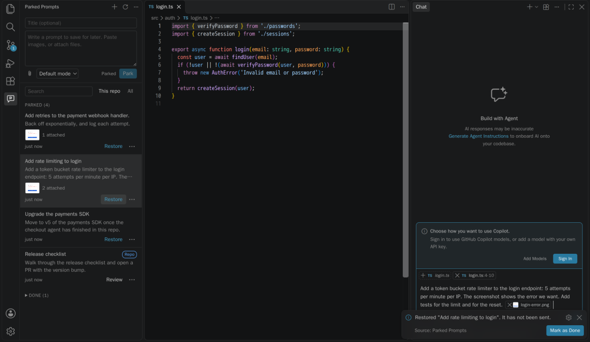

# Parked Prompts

**[Website](https://jamesmontemagno.github.io/parked-prompts/)** · **[Docs](https://jamesmontemagno.github.io/parked-prompts/docs/)** · **[Marketplace](https://marketplace.visualstudio.com/items?itemName=vs-publisher-473885.parked-prompts)**

[](https://vscode.dev/redirect?url=vscode:extension/vs-publisher-473885.parked-prompts) [](https://vscode.dev/redirect?url=vscode-insiders:extension/vs-publisher-473885.parked-prompts)

Save chat prompts with their files and images for later, without sending them. Bring them back when the codebase is free.



Other agents are often working in the same checkout, so a prompt you just thought of can't run yet. Parked Prompts keeps it safe, then restores it to chat, or runs it in a worktree straight away.

**Status: pre-release.** The extension has been driven end to end on VS Code Insiders 1.146, and its smoke tests also pass on stable. Some canvas behavior still needs a signed-in session to confirm. See [Phase 0 results](docs/spike-results.md).

## What's here

| Piece | What it does | Where |
|---|---|---|
| **Editor extension** | Composer and list in the sidebar, restore to chat, run in a worktree, move to the repo | [`packages/extension`](packages/extension) |
| **Canvas** | The same list inside a chat session, plus send, queue, and send when idle | [`packages/canvas`](packages/canvas) |
| **Core** | The on-disk store they share | [`packages/core`](packages/core) |
| **Website** | The landing page, docs, and security model | [`site`](site) |

The extension and the canvas don't talk to each other. They read the same folder, so a prompt parked in one appears in the other.

## Install

### Editor extension

[](https://vscode.dev/redirect?url=vscode:extension/vs-publisher-473885.parked-prompts) [](https://vscode.dev/redirect?url=vscode-insiders:extension/vs-publisher-473885.parked-prompts)

The buttons open the extension in your editor, ready to install. Or use the command line, with `code-insiders` for Insiders:

```sh
code --install-extension vs-publisher-473885.parked-prompts
```

Or build a VSIX from source:

```sh
pnpm install
pnpm package:vsix
code --install-extension packages/extension/dist/parked-prompts.vsix
```

### Canvas

The canvas is a separate Copilot plugin, not part of the VSIX. In VS Code, open **Chat: Open Customizations**, then **Browse** > **Configure Marketplaces** > **Add Marketplace** (or **Plugins** > **Browse Marketplace**). Add `jamesmontemagno/parked-prompts`, browse that marketplace, and install `parked-prompts`.

Adding a marketplace does not install its plugin.

Or use the CLI:

```sh
copilot plugin marketplace add jamesmontemagno/parked-prompts
copilot plugin install parked-prompts@parked-prompts
```

Or from a local build:

```sh
pnpm --filter parked-prompts-canvas build
copilot plugin marketplace add ./packages/canvas/dist/marketplace
copilot plugin install parked-prompts@parked-prompts
```

Start a fresh **Copilot** session, then ask your agent to open the parked prompts canvas. Local, Claude, and Codex sessions cannot load it.

Releases are covered in [RELEASING.md](RELEASING.md).

## Using it

Repository filters and prompt labels show the repo name. Hover to see the owner and full name when available; search still matches the full label.

### Park a prompt

Open **Parked Prompts** in the activity bar and write. It saves a draft as you type. Paste images, attach files, and press **Park**.

There are quicker ways from the editor:

| Action | How |
|---|---|
| Park what you typed in chat | `Ctrl+Alt+P` / `Cmd+Alt+P` in the chat input. Text only, see [limits](#limits) |
| Park a selection | **Park Selection** in the editor's context menu |
| Park with a file | **Park Prompt with This File** in the Explorer's context menu |

### Restore it

Press the **Draft in chat** icon on a prompt. It goes into a new chat with its attachments, and **is never sent**. You read it and press send yourself. The neighboring icons edit it, copy its text (without attachments), or delete it after confirmation.

Choose the agent and harness in VS Code. In the editor, restore uses a saved model when available. Rows show the saved model; the canvas shows it but sends with the session's model.

Restore keeps the prompt, because an extension can't see whether you sent it. Mark it done when you're finished.

Set `parkedPrompts.restoreTarget` to `currentChat` to use the current chat instead. It warns before replacing text you've typed.

### Run it in a worktree

**Run in a worktree…** starts a prompt now without touching your busy checkout. Confirm the branch and folder, and a new window opens on the worktree with the prompt in a new chat, unsent. Worktrees are never deleted for you.

### Send from the canvas

| Action | What happens |
|---|---|
| **Send** | Sends to this session now, steering the current turn if there is one |
| **Queue** | Sends after the current turn |
| **When idle** | Sends once the agent goes idle, one prompt at a time, while the canvas stays open |
| **Copy** | Copies the text so you can paste it into the chat box and edit it before sending. Attachments are not copied |

A short tips card opens the first time you use the canvas or the sidebar. Reopen it from the info button.

In the canvas and the sidebar, the sweep icon beside **Done** deletes the completed prompts currently shown, after confirmation. Copied attachments are deleted too; referenced workspace files are kept. Repository-stored prompts are removed from the working tree.

The agent can list and read prompts and save new drafts. It can't send or arm one: only you can, from the canvas.

### Share one with your team

**Move to repository…** puts a prompt in `.github/parked-prompts/` for you to commit. It first lists exactly which files will be added, and warns about screenshots and anything that looks like a secret. It removes your local path and never commits for you.

## Prompts from a repository are untrusted

Anyone with commit access can add a prompt to `.github/parked-prompts/`, and a prompt instructs your agent. So:

- **You read it before it's used.** It opens read-only, with hidden characters made visible, and needs a yes before it can be copied, restored, sent, or armed.
- **A yes covers that exact content.** If a pull changes the text, an attachment, or a file it refers to, it asks again.
- **It's never run automatically.**
- **Untrusted workspaces hide these prompts entirely**, in the editor.
- **Attachments can't reach outside.** A symlink pointing out of its folder is blocked, and so is any path with `..`. A repo store that is itself a symlink is not used at all.

## Where prompts live

| Store | Location | Notes |
|---|---|---|
| Personal | `~/.parked-prompts/<id>/` | Private to your user. `PARKED_PROMPTS_HOME` overrides it |
| Repository | `.github/parked-prompts/<id>/` | Opt-in per prompt, committed by you |

Each entry is a `prompt.md` you can read and edit, plus an `attachments/` folder:

```markdown
---
schema: 1
title: Add rate limiting to login
createdAt: 2026-11-05T16:52:00.000Z
updatedAt: 2026-11-05T16:52:00.000Z
status: parked
repo:
  remote: github.com/contoso/checkout-api
  path: /work/checkout-api
attachments:
  - { kind: workspace, path: src/auth.ts, range: { startLine: 1, endLine: 3 } }
  - { kind: copy, path: attachments/login-error.png, name: login-error.png, mime: image/png, size: 4120, sha256: "…" }
---

Add a token bucket rate limiter to the login endpoint.
```

- **Images and files outside the workspace are copied in.** Other workspace files stay references, so restoring attaches their current version. A missing one is flagged rather than failing the restore.
- **Prompts follow the repository, not the folder.** They match by Git remote first, so they survive re-clones and worktrees. Remote URLs are stored without credentials.
- **Limits:** 25 MB per attachment, 100 MB per prompt, 50 attachments.

## Limits

These come from what VS Code and Copilot allow today. [Phase 0 results](docs/spike-results.md) has the evidence for each.

- **Attachments already in the chat input can't be captured.** VS Code has no API to read them, so "Park what I typed" saves the text only. Add attachments in the composer.
- **The Agents window has no sidebar views, and restore there is text only.** Files are listed by path in the text. Use the canvas there for real attachments.
- **There's no Park button in the chat input yet.** In Insiders 1.146 it appears but clicking it does nothing, because of a VS Code issue affecting every extension. It's behind `parkedPrompts.experimental.chatInputButton` for when that's fixed.
- **Restore uses VS Code's internal chat commands.** They could change in any build. They all sit in [one file](packages/extension/src/chatAdapter.ts), and [`tools/phase0`](tools/phase0) re-checks them.
- **The canvas needs the Copilot harness.** It doesn't work in Local, Claude, or Codex sessions.
- **Send when idle only runs while the canvas stays open**, and only in its own session. Reloading the window disarms it, which errs on the side of not sending.
- **The editor can't offer send when idle**, because stable APIs can't see whether chat is busy.

## Development

Needs Node.js 24 and pnpm. See [CONTRIBUTING.md](CONTRIBUTING.md).

```sh
pnpm install
pnpm check         # build, typecheck, lint, unit tests, website check
pnpm e2e           # canvas browser tests
pnpm test:vscode   # smoke tests inside real VS Code
pnpm preview:site  # the website, locally
```

## License

[MIT](LICENSE)
