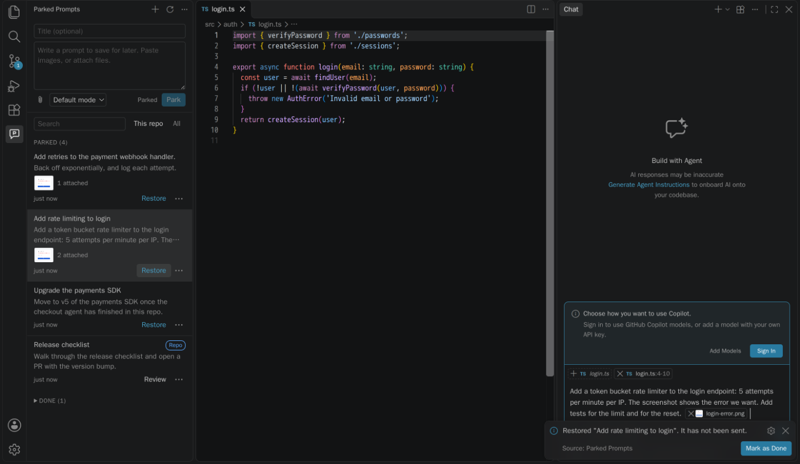
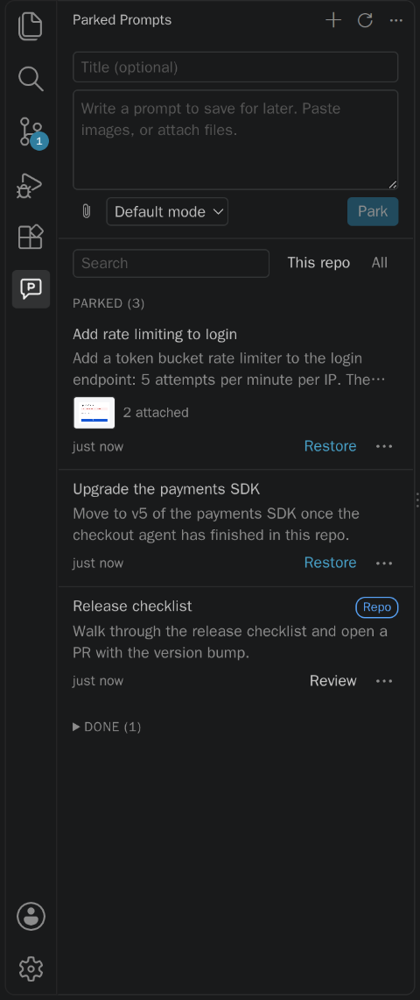
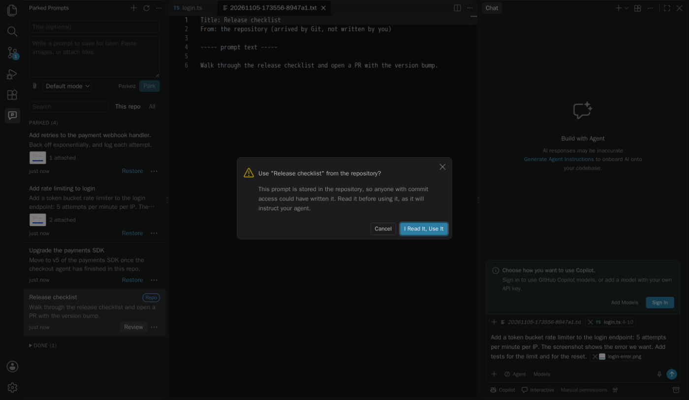
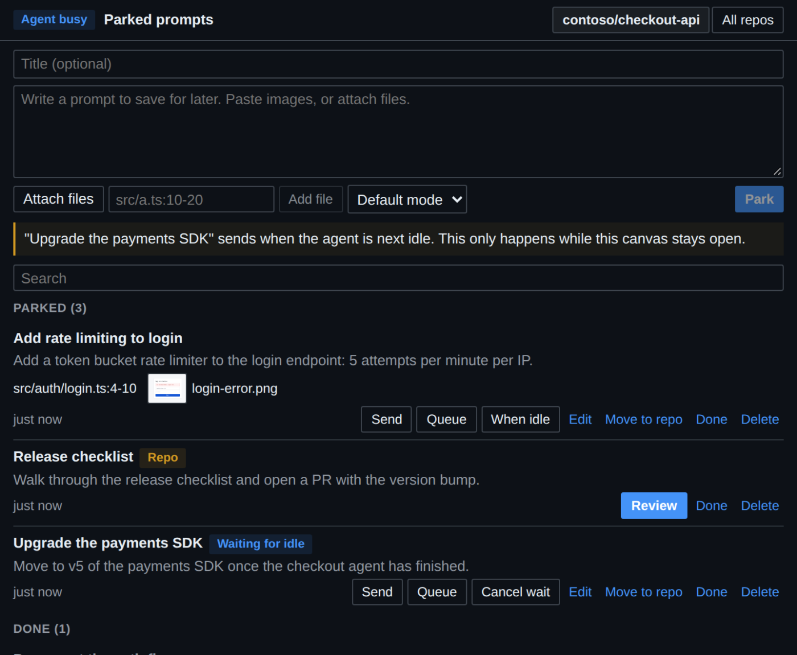

# Parked Prompts

**The agent's busy, so park the prompt.** Save a chat prompt with its files and images, without sending it. Bring it back when the codebase is free, or run it in a worktree right now.

## Why

When another agent is mid-change in your checkout, starting a second one causes conflicts, and sitting on the idea means losing it. So keep it somewhere safe, with everything it needs.

## What it does

- **Park a prompt.** Write in the sidebar, paste a screenshot, and attach files. It saves as you type, and nothing goes to any model.
- **Restore it, unsent.** It goes back into a new chat with its attachments. You read it and press send yourself.
- **Run it in a worktree.** Start now, without touching the busy checkout: a new window opens on a new branch, with the prompt waiting.
- **Keep them per repository.** Prompts match by Git remote, so they survive re-clones and worktrees.
- **Share with your team.** Move a prompt to `.github/parked-prompts/` to commit it. It lists exactly what will be added, and warns about screenshots and secrets.
- **Quick capture.** `Ctrl+Alt+P` (`Cmd+Alt+P` on a Mac) in the chat input parks what you typed. Park a selection or a file from their context menus.

## Prompts from Git are read first

Anyone with commit access can add a prompt to a repository, and a prompt instructs your agent. So it opens read-only, with hidden characters shown, and needs your yes before it can be used. If a pull changes it, or a file it refers to, it asks again. In an untrusted workspace, these prompts are hidden.

## Send when idle, with the canvas

The optional [Copilot canvas](https://jamesmontemagno.github.io/parked-prompts/integrations/#canvas) gives you the same list inside a session, and can send a prompt now, after this turn, or when the agent next goes idle. Only you can send. The agent can only read and save drafts.

## Good to know

- **Attachments already in the chat input can't be captured.** VS Code has no API to read them, so parking what you typed saves the text only. Add attachments in the composer.
- **Restoring uses VS Code's internal chat commands,** which could change in any build. This is a preview for that reason.
- **The Agents window takes text only,** so restoring there lists files by path. Enabling the extension there needs no setting.

See [all the limits](https://jamesmontemagno.github.io/parked-prompts/docs/#limits), or the [docs](https://jamesmontemagno.github.io/parked-prompts/docs/) and [security model](https://jamesmontemagno.github.io/parked-prompts/security/).
